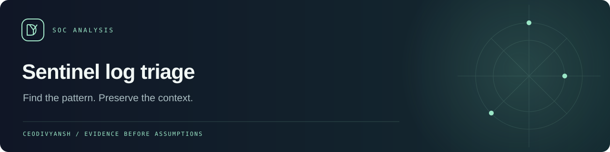

# Sentinel log triage

**Find the pattern. Preserve the context.**

`Python 3.11+` · `Standard library` · `Offline` · `Synthetic examples`

An offline CLI that turns normalized authentication events into reviewable findings. It detects rolling failure bursts and checks for a later successful sign-in from the same source for one of the affected usernames.

| Input | Analysis | Output |
| --- | --- | --- |
| JSONL authentication events | Per-IP rolling windows, contextual success correlation | JSON evidence + Markdown summary |

## Detection logic

- Sort events by timezone-aware timestamp and normalize source IP addresses.
- Find the largest inclusive rolling failure window for each source IP.
- Report one peak per IP when the configured threshold is met.
- Flag a subsequent success only for the same source and one of the usernames in the peak.

Default settings are **5 failures in 300 seconds**. These are demonstration parameters, not a universal production detection rule. A finding does not establish malicious intent or compromise. The tool does not model distributed attacks, NAT identity, device context, or full SIEM correlation.

## Event contract

```json
{"timestamp":"2026-01-01T09:00:00Z","source_ip":"192.0.2.10","username":"analyst","result":"failure"}
```

`result` must be `success` or `failure`. Timestamps must include a timezone. Malformed records stop processing with a line number, rather than being silently discarded.

## Quick start

```bash
git clone https://github.com/PROxZONE/sentinel-log-triage.git
cd sentinel-log-triage
python3 triage.py examples/auth-events.jsonl --json out/report.json --markdown out/report.md
```

## Example artifacts

See [`examples/`](examples/) for the sample inputs and [`sample-output/`](sample-output/) for generated results. Run the command above to reproduce them locally. Example IPs and domains are documentation data, not testing targets.

## Development

Python 3.11 or newer. No third-party packages are required.

```bash
python3 -m unittest discover -s tests -v
```

Use synthetic or appropriately sanitized data when contributing examples. Describe the observed behavior, the expected behavior, and a reproducible command in an issue.

## About this project

A learning project in [Divyansh Yadav’s cybersecurity portfolio](https://ceodivyansh.com). The examples are fictional and are not evidence of a completed client engagement or production deployment.
